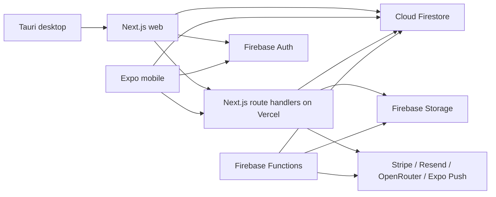

# AutoCore Architecture

## System overview

AutoCore is a multi-surface TypeScript product built around Firebase as the shared system of record.



Vercel hosts the Next.js application and its route handlers. Firebase independently hosts authentication, data, file storage, realtime subscriptions, and background functions.

## Application boundaries

### Presentation

- `src/app/`: routes, layouts, server entry points, and API handlers.
- `src/components/`: product UI and reusable primitives.
- `src/hooks/`: client-side subscriptions and application state integration.

Presentation code should not be imported by server or domain modules.

### Application

- `src/application/use-cases/`: business operations coordinating repositories and domain rules.

Use cases should express user intent such as moving stock, transitioning a work order, or committing an import. They should not depend on React.

### Domain

- `src/domain/`: entities, schemas, state transitions, and business invariants.
- `packages/rbac/`: cross-client role and permission semantics.
- `packages/org/`: shared organization contracts and errors.

Domain code should remain deterministic and infrastructure-independent where practical.

### Infrastructure

- `src/infrastructure/firebase/`: Firebase client and Admin SDK initialization.
- `src/infrastructure/firestore/`: repositories and persistence mappings.
- `firebase/functions/`: deployed Firebase background and callable functions.

Infrastructure modules own external SDK details and persistence formats.

### Server services

- `src/lib/`: server workflows, document engines, imports, mobile API services, and shared utilities.

This directory contains both reusable utilities and legacy business services. New business operations should prefer a domain or application use case when that produces a clearer boundary.

## Multi-tenant data model

The primary tenant is a company:

```text
companies/{companyId}
  employees/{uid}
  roles/{roleId}
  billing/subscription
  settings/app
  workOrders/{workOrderId}
  warehouseLocations/{locationId}
```

Some operational collections are top-level and carry `companyId`. Every client query and server mutation must bind that field to the authenticated user's active company.

User profiles live under `users/{uid}`. Company authority must come from the target company's employee/owner records, not solely from a global user role.

## Authentication and authorization

- Firebase Auth issues client ID tokens.
- Web and mobile APIs send tokens in the `Authorization: Bearer` header.
- Server routes verify tokens with Firebase Admin.
- Firestore rules protect direct client access.
- RBAC permissions are shared through `@autocore/rbac`.

Authorization belongs at both boundaries:

1. Firestore rules for direct client reads and writes.
2. Server-side company and permission checks for Admin SDK operations.

Admin SDK bypasses Firestore rules, so every Admin operation must perform explicit tenant authorization.

## Realtime data

Firestore `onSnapshot` listeners provide most live product updates. Repositories map Firestore documents into domain models, and hooks expose subscriptions to UI workspaces.

Guidelines:

- Reuse subscriptions when multiple components need the same query.
- Bound large collections with limits or pagination.
- Unsubscribe when a workspace is no longer active.
- Do not silently truncate business data.

## Warehouse integrity

Warehouse state is represented by inventory records, location balances, and immutable movement history. Stock-affecting operations must:

1. validate company and permission scope;
2. validate source availability;
3. write the movement;
4. update affected balances atomically where possible;
5. preserve idempotency for retried jobs.

Do not update stock fields directly from UI components when a use case exists.

## Documents

The document pipeline:

1. creates or reuses a generation job;
2. loads company and order context;
3. builds a typed render model;
4. renders application-controlled HTML;
5. generates PDF through Chromium;
6. stores the result in Firebase Storage;
7. updates the job and document records.

Vercel document routes have extended memory and duration in `vercel.json`. Firebase Functions may trigger work, but generated `firebase/functions/lib/` output is not committed.

## Imports and AI

Import routes accept spreadsheets, documents, photos, and archives. AI-assisted extraction uses OpenRouter from server-only modules.

AI output is untrusted input. It must pass the same schema validation and review flow as user-entered data before commit.

## Deployment ownership

| Component | Platform | Deployment source |
|---|---|---|
| Web and API routes | Vercel | repository root |
| Authentication | Firebase | Firebase Console/configuration |
| Firestore rules and indexes | Firebase | `firestore.rules`, `firestore.indexes.json` |
| Storage | Firebase | bucket configuration and rules |
| Background functions | Firebase Functions | `firebase/functions/src/` |
| Mobile | Expo/EAS | `autocore-mobile/` |
| Desktop | Tauri release process | `src-tauri/` |

## High-risk change areas

Require targeted tests and manual review for:

- Firestore security rules and indexes.
- Company membership, roles, and invitations.
- Billing and Stripe callbacks.
- Warehouse movement and balance logic.
- Work-order state transitions.
- Document tokens, queues, and PDF rendering.
- Import commit paths.
- Cross-client inventory schema changes.

## Architecture decision guidance

- Prefer one domain operation shared by web and mobile route wrappers.
- Keep React modules out of server dependencies.
- Keep credentials and environment reads at server/infrastructure boundaries.
- Introduce shared packages only for behavior genuinely used by multiple clients.
- Document migrations before changing persisted field meaning.
